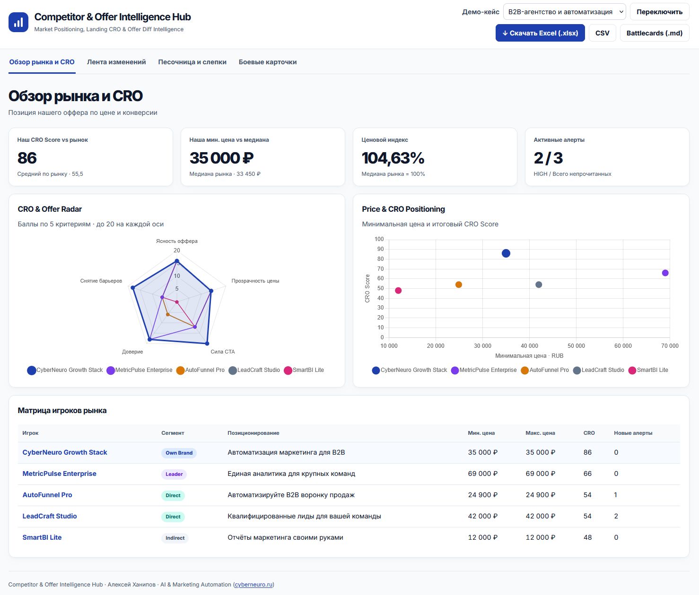
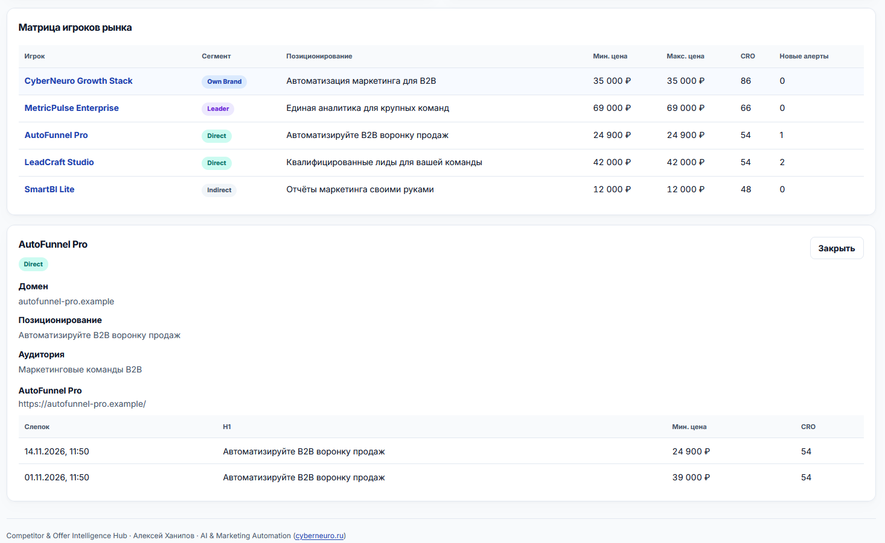
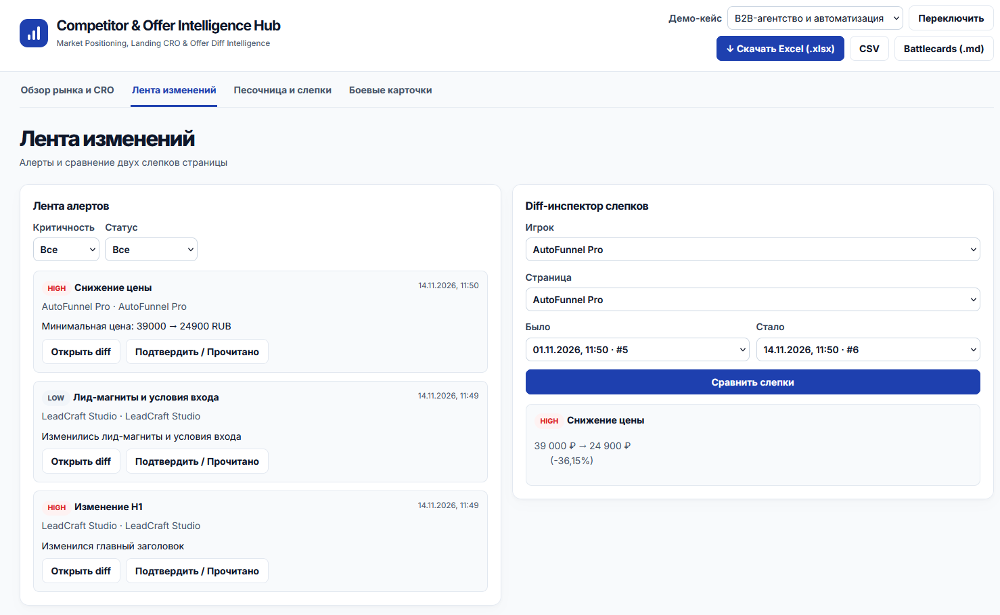
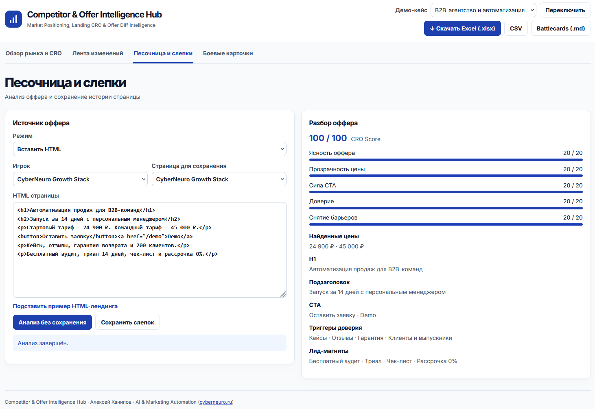
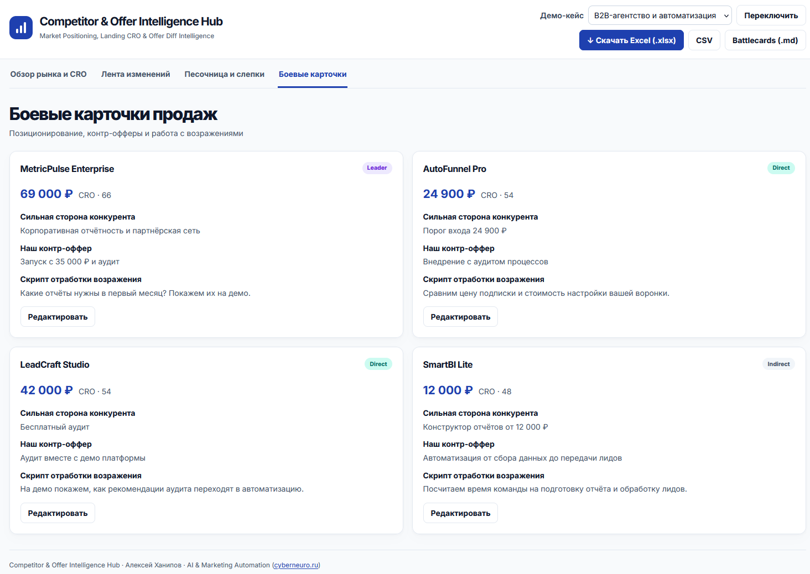

# Competitor & Offer Intelligence Hub

Система конкурентной разведки, мониторинга цен и офферов и CRO-аудита посадочных страниц. Продукт №4 из шести в линейке **Marketing & Growth Ops**.

**Алексей Ханипов · AI & Marketing Automation | [cyberneuro.ru](https://cyberneuro.ru)**

[Презентация продукта](presentation.html) · [Экономика внедрения](BUSINESS_CASE.md) · [Быстрый старт](#быстрый-старт) · [Исходный код на GitHub](https://github.com/alex-hash986/Competitor-Offer-Intelligence-Hub)

## Решаемые бизнес-задачи

В ручной таблице видна последняя введённая цена. Чтобы понять, когда она изменилась и что ещё произошло с оффером, команде приходится заново открывать страницы, искать прошлые версии и сверять заметки. Hub хранит датированные слепки и показывает изменения между ними.

- **Продуктовый маркетинг** ведёт сравнительную матрицу и видит, где собственный оффер уступает рынку по цене или упаковке.
- **Перформанс-команда** сверяет оффер перед запуском рекламного теста и проверяет новую версию лендинга в песочнице.
- **Продажи** используют актуальные контр-офферы и скрипты из Sales Battlecards при сравнении с конкурентами.

## Возможности и архитектура

| Компонент | Что делает |
| --- | --- |
| Гибридный сбор | `live_url` загружает публичный HTTP(S)-адрес с проверкой IP на каждом редиректе и подключением к проверенному адресу для защиты от SSRF в приватные сети. `raw_html`, `json_snapshot` и `manual_text` позволяют анализировать данные локально. Доступна загрузка файлов `.html` и `.json`. |
| CRO & Offer Readiness Score | Оценивает пять критериев по 0–20 баллов каждый. Учитывает ясность УТП, прозрачность цены, силу CTA, сигналы доверия и снижение барьеров. Сумма от 0 до 100 помогает сравнивать упаковку офферов. Фактическую конверсию команда измеряет в аналитике. |
| Snapshot Diff Engine | При сохранении сравнивает слепок с предыдущим на той же странице. Создаёт алерты `HIGH`, `MEDIUM`, `LOW` при изменениях цены, H1, CTA, сигналов доверия и лид-магнитов. |
| Sales Battlecards | Команда редактирует контр-офферы и скрипты в приложении и формирует из них бриф для отдела продаж. |
| Рыночная аналитика | Сравнивает собственный CRO Score со средним по рынку. Ценовой индекс равен нашей минимальной цене, делённой на медиану минимальных цен конкурентов в той же валюте, × 100%. |
| Экспорт | Excel с листами Executive Summary, CRO & Offer Matrix, Change Alerts Log и Sales Battlecards, CSV с UTF-8 BOM и разделителем `;`, а также Markdown-бриф для Notion, Yonote или Confluence. |
| Демо-кейсы | `b2b_agency` показывает конкуренцию агентств и платформ автоматизации, `edtech` показывает рынок онлайн-обучения. В каждом кейсе пять игроков и десять слепков. |

**Стек.** Python 3.12+, FastAPI, Pydantic v2, SQLAlchemy 2.0, SQLite или PostgreSQL 16. httpx загружает страницы, Beautiful Soup и lxml разбирают HTML, openpyxl формирует Excel. SPA использует HTML, CSS и JavaScript без сборки. При недоступности Chart.js вместо диаграмм отображаются таблицы.

## Галерея интерфейса

### Обзор рынка и CRO

KPI собственного бренда и рынка, радар пяти критериев и позиционирование игроков по цене и CRO.



### Рыночная матрица и карточка игрока

Из матрицы можно открыть профиль конкурента, его страницы и историю слепков.



### Лента алертов и Diff-инспектор

Фильтры помогают найти новые изменения. Инспектор показывает, что изменилось между двумя версиями страницы.



### Песочница офферов

Предпросмотр показывает CRO Score, цены, CTA и другие элементы оффера до сохранения слепка.



### Sales Battlecards

В карточке конкурента можно обновить контр-оффер и скрипт работы с возражениями.



## Быстрый старт

### Локально с SQLite

PowerShell, из корня проекта:

```powershell
py -m venv .venv
.\.venv\Scripts\python.exe -m pip install -r requirements.txt
Copy-Item .env.example .env
.\.venv\Scripts\python.exe -m uvicorn app.main:app --reload
```

На macOS и Linux используйте `python3 -m venv .venv`, `cp .env.example .env` и `.venv/bin/python`. Если `.env` уже настроен, сохраните существующий файл.

### Развёртывание с PostgreSQL 16

При необходимости скопируйте `.env.example` в `.env` и задайте `POSTGRES_DB`, `POSTGRES_USER` и `POSTGRES_PASSWORD`. Для локального демо Compose подставляет значения по умолчанию.

```sh
docker compose config --quiet
docker compose up --build
```

Контейнер приложения запускается от пользователя `appuser` после успешной проверки PostgreSQL. Compose передаёт приложению отдельный `DATABASE_URL`, а локальный Uvicorn использует значение из `.env`. Если реквизиты содержат спецсимволы, задайте `COMPOSE_DATABASE_URL` с URL-кодированием. База хранится в томе `competitor_intel_pgdata`.

Текущая поставка рассчитана на выделенный контур с ограниченным доступом. При внешнем развёртывании задайте собственные реквизиты БД и ограничьте доступ к HTTP через аутентифицирующий reverse proxy с TLS. API текущей версии доступен без встроенной аутентификации. Смена демо-кейса заменяет текущих игроков, слепки, алерты и боевые карточки в активной БД.

[Приложение](http://127.0.0.1:8000/) · [Swagger UI](http://127.0.0.1:8000/docs) · [Health check](http://127.0.0.1:8000/api/health)

При первом запуске на пустой БД загружается `b2b_agency`.

## Основные REST API

| Метод и путь | Назначение |
| --- | --- |
| `GET /api/health` | Статус приложения, демо-кейс и счётчики |
| `GET /api/competitors`, `POST /api/competitors` | Список и добавление игроков |
| `GET /api/competitors/{id}`, `POST /api/pages` | Профиль с историей слепков и добавление страницы |
| `PUT /api/competitors/{id}/battlecard` | Создание или обновление карточки продаж |
| `POST /api/snapshots/capture`, `POST /api/snapshots/upload` | Запись слепка из запроса или файла с созданием алертов |
| `POST /api/snapshots/preview` | Анализ оффера без сохранения |
| `GET /api/snapshots/diff?old_id=…&new_id=…` | Сравнение двух слепков одной страницы |
| `GET /api/analytics/overview` | KPI, данные радара и ценовой матрицы |
| `GET /api/alerts`, `PATCH /api/alerts/{id}/ack` | Лента с фильтрами и отметка о прочтении |
| `GET /api/demo/cases`, `POST /api/demo/reset` | Список демо-кейсов и замена текущего набора данных |
| `GET /api/exports/excel`, `GET /api/exports/csv`, `GET /api/exports/battlecards.md` | Скачивание отчётов |

## Автотесты

Из активированного виртуального окружения:

```sh
pytest -W error
```

В Windows можно запустить `.\.venv\Scripts\python.exe -m pytest -W error`. По умолчанию тесты используют временную SQLite. Для проверки на PostgreSQL передайте `TEST_DATABASE_URL` с реквизитами тестового пользователя, который может создавать схемы.
